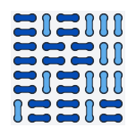
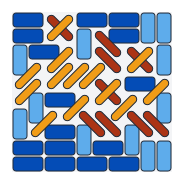
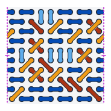
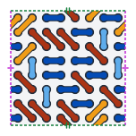

#  Lattice Dimers

[](https://github.com/dawidrylko/lattice-dimers/actions/workflows/ci.yml)
[](https://github.com/dawidrylko/lattice-dimers/actions/workflows/pages.yml)
[](https://dawidrylko.github.io/lattice-dimers/papers/king-entropy.pdf)
[](https://doi.org/10.5281/zenodo.23686293)
[](https://dawidrylko.github.io/lattice-dimers/)

Research code, data and papers on dimer coverings of two lattices: the square lattice, whose perfect matchings are domino tilings, and the king's graph, the square lattice with both diagonals, whose perfect matchings are domicule tilings. The repository holds a paper on the entropy per site of the king's graph dimers with its companion note, exact solvers for rectangles, cylinders and tori, and the OEIS entries built on them.

<table>
  <tr>
    <td align="center"></td>
    <td align="center"></td>
    <td align="center"></td>
    <td align="center"></td>
  </tr>
  <tr>
    <td align="center">dominoes, 8 × 8</td>
    <td align="center">domicules, 8 × 8</td>
    <td align="center">domicules, 8 × 8 cylinder</td>
    <td align="center">domicules, 8 × 8 torus</td>
  </tr>
</table>

## Site

The [site](https://dawidrylko.github.io/lattice-dimers/) opens on two tabs, and its header menu lists the notebooks.

- [Gallery](https://dawidrylko.github.io/lattice-dimers/#gallery): numbers the tilings of a rectangle, a cylinder or a torus and draws any one of them. It opens on the 8 × 8 board, and it samples the boards too large to number.
- [Benchmarks](https://dawidrylko.github.io/lattice-dimers/#benchmark): the exact counts and the running times of the solvers in Rust, Python and JavaScript. The Pieces and Surface switches choose one of six tables.

| menu | notebooks |
| --- | --- |
| Research | [Research](https://dawidrylko.github.io/lattice-dimers/notes/research.html) |
| Dominoes | [Rectangles](https://dawidrylko.github.io/lattice-dimers/notes/dominoes/rectangles.html), [Cylinders](https://dawidrylko.github.io/lattice-dimers/notes/dominoes/cylinders.html), [Tori](https://dawidrylko.github.io/lattice-dimers/notes/dominoes/tori.html) |
| Domicules | [Rectangles](https://dawidrylko.github.io/lattice-dimers/notes/domicules/rectangles.html), [Cylinders](https://dawidrylko.github.io/lattice-dimers/notes/domicules/cylinders.html), [Tori](https://dawidrylko.github.io/lattice-dimers/notes/domicules/tori.html), [Diagonal pieces](https://dawidrylko.github.io/lattice-dimers/notes/domicules/diagonal-pieces.html) |
| Triangular lattice | [Cylinders](https://dawidrylko.github.io/lattice-dimers/notes/triangular-lattice/cylinders.html), [Tori](https://dawidrylko.github.io/lattice-dimers/notes/triangular-lattice/tori.html) |

## Results

The king's graph is not planar, and its boards with both sides at least 3 admit no Pfaffian orientation, so Kasteleyn's method does not apply. Transfer matrices on cylinders of circumference up to 25, split by a conserved parity, give the entropy per site; computer-assisted certificates prove a two-sided bound.

| quantity | value | status |
| --- | --- | --- |
| entropy per site $s$ | 0.5655119110413253 ± 6·10⁻¹⁶ | estimate, not rigorous |
| bounds on $s$ | 0.545343749727 ≤ s ≤ 0.582767477484 | proved, computer-assisted |
| surface free energy $\sigma$ of a free edge | 0.242017935766251 ± 9·10⁻¹⁵ | estimate |
| corner free energy $\kappa$ | 0.36319625605 ± 3·10⁻¹⁰ | estimate |
| decay length $\xi$ of the parity splitting | 1.236091 ± 10⁻⁶ | estimate |

- Paper: *The dimer entropy of the king's graph* ([PDF](research/king-entropy/paper/king-entropy.pdf), [doi:10.5281/zenodo.23686056](https://doi.org/10.5281/zenodo.23686056)).
- Companion note: *Log-convexity of strip dimer counts on the king's graph* ([PDF](research/king-entropy/paper/king-entropy-log-convexity.pdf), [doi:10.5281/zenodo.23686087](https://doi.org/10.5281/zenodo.23686087)).
- Code and data of the tag `king-entropy-v1.0.0`: [doi:10.5281/zenodo.23686293](https://doi.org/10.5281/zenodo.23686293).

## Repository

| directory | contents |
| --- | --- |
| [`research/king-entropy`](research/king-entropy/README.md) | scripts, data, outputs, proofs and papers on the entropy of the king's graph |
| [`oeis`](oeis/README.md) | the OEIS entries this repository contributed to, with their b-files and PARI/GP programs |
| [`notes`](notes/README.md) | notebooks on dominoes and domicules on rectangles, cylinders and tori, on the triangular lattice on cylinders and tori, and on the research, built into the [site](https://dawidrylko.github.io/lattice-dimers/) |
| [`spec`](spec/README.md) | the solver contract, the registry of algorithms and the known counts every implementation and program is checked against |
| [`rust`](rust/README.md) | the Rust solvers, for the algorithms [`spec/algorithms.json`](spec/algorithms.json) lists with Rust, and the library they share; the workspace manifest is [`Cargo.toml`](Cargo.toml) at the root |
| [`python`](python/README.md) | the Python package `lattice_dimers`: the Python solvers, for the algorithms `spec/algorithms.json` lists with Python, and the library they share |
| [`js`](js/README.md) | the JavaScript solvers for rectangles, cylinders and tori, and the renderer that numbers, samples and draws tilings |
| [`docs`](docs/glossary.md) | the glossary of the words the repository uses for pieces, lattices, surfaces, signs, the site and the code |
| [`harness`](harness/README.md) | the test runners, the check that keeps the languages in step, and the benchmark runner |
| [`benchmarks`](benchmarks/README.md) | the benchmark results |
| `site` | the build of the [site](https://dawidrylko.github.io/lattice-dimers/): the gallery, the benchmark tables and the notebooks |

## Quick start

Node.js 26 or newer (`.nvmrc`) and pnpm, with Rust 1.99 and Python 3.13 or newer for the other two languages, which `pnpm test` also runs. Rust is the first language, Python the second and JavaScript the third; [`spec/algorithms.json`](spec/algorithms.json) lists the implementations each algorithm has. The three commands below count the same board, the 8 × 8 rectangle, and each prints 3263262629905 domicule tilings:

```sh
git clone https://github.com/dawidrylko/lattice-dimers.git
cd lattice-dimers
pnpm install
node js/solvers/domiculeTilingSolver-Modular.js -r 8 -c 8
cargo build --release
target/release/domicule-tiling-modular -r 8 -c 8
python3 -m pip install -e python
python3 -I -m lattice_dimers.solvers.domicule_tiling_modular -r 8 -c 8
pnpm test
pnpm site:build
```

## Citation

[`CITATION.cff`](CITATION.cff) holds the metadata of the repository, and GitHub offers it as BibTeX under "Cite this repository". For the entropy of the king's graph, cite the paper as given on the [research page](https://dawidrylko.github.io/lattice-dimers/notes/research.html#how-to-cite).

## License

The code is MIT, see [LICENSE](LICENSE). Text and data are licensed under
[CC BY 4.0](https://creativecommons.org/licenses/by/4.0/), see
[LICENSES/CC-BY-4.0.txt](LICENSES/CC-BY-4.0.txt). CC BY 4.0 covers exactly these paths:

- text: `research/king-entropy/paper/`, `research/king-entropy/proofs/`, `research/king-entropy/notes/`,
  `research/king-entropy/release/`, `research/king-entropy/replication/REPORT.md` and `notes/`;
- data: `research/king-entropy/data/`, `research/king-entropy/out/`, `research/king-entropy/logs/`,
  `research/king-entropy/replication/out/`, the outputs `research/king-entropy/log-convexity/out_*.txt` and
  `research/king-entropy/log-convexity/time_*.txt`, the JSON files in `spec/cases/` and the measurements in `benchmarks/results/`.

Everything else is MIT, in particular all programs and scripts: `rust/`, `python/`, `js/`, `oeis/`, `site/`, `harness/`, `research/king-entropy/src/`,
`research/king-entropy/log-convexity/*.py` and the code in `research/king-entropy/replication/`.

## Author

[Dawid Ryłko](https://dawidrylko.com), ORCID [0009-0008-6307-9015](https://orcid.org/0009-0008-6307-9015).

The project began as two blog posts in Polish, [Domino Tiling](https://dawidrylko.com/domino-tiling/) and [Domino tiling library](https://dawidrylko.com/domino-tiling-library/), which describe the first domino solvers and their test and benchmark runners. The domicule solvers, the research on the king's graph and the OEIS entries grew from that code.
