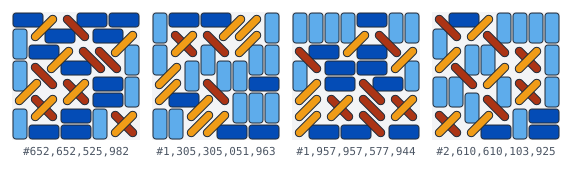
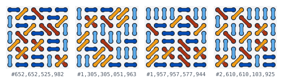
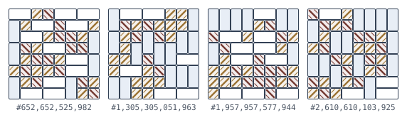

# Solvers and renderer

The [method note](../notes/01-method.md) explains how each count is made; this page lists the programs and how to run them.

## Solvers

Each solver is a command-line program that prints the number of tilings of one board.

| file | what it counts | method |
| --- | --- | --- |
| [`dominoTilingSolver.js`](solvers/dominoTilingSolver.js) | domino tilings | transfer by rows, `Number` (exact up to 10 × 10) |
| [`dominoTilingSolver-BigInt.js`](solvers/dominoTilingSolver-BigInt.js) | domino tilings | transfer by rows, `BigInt` |
| [`dominoTilingSolver-Formula.js`](solvers/dominoTilingSolver-Formula.js) | domino tilings of the 2n × 2n square | the product formula as a resultant |
| [`domiculeTilingSolver-BigInt.js`](solvers/domiculeTilingSolver-BigInt.js) | domicule tilings | transfer by cells, `BigInt` (reference) |
| [`domiculeTilingSolver-Modular.js`](solvers/domiculeTilingSolver-Modular.js) | domicule tilings | transfer by cells modulo primes, worker threads, Chinese remainder theorem |
| [`periodicTilingSolver-BigInt.js`](solvers/periodicTilingSolver-BigInt.js) | cylinders and tori on the square lattice, the triangular lattice and the king's graph | transfer by rows, `BigInt` (reference) |
| [`periodicTilingSolver-Modular.js`](solvers/periodicTilingSolver-Modular.js) | the same | transfer by cells modulo primes |
| [`domiculeDiagonalSolver-BigInt.js`](solvers/domiculeDiagonalSolver-BigInt.js) | domicule tilings by the number of diagonal pieces | transfer by cells, `BigInt` (reference) |
| [`domiculeDiagonalSolver-Modular.js`](solvers/domiculeDiagonalSolver-Modular.js) | the same | transfer by cells modulo primes |

```sh
node src/solvers/dominoTilingSolver-Formula.js -r 20 -c 20
node src/solvers/domiculeTilingSolver-Modular.js -r 20 -c 20 -j 8                # -j sets the number of worker threads
node src/solvers/periodicTilingSolver-Modular.js -r 12 -c 12 --torus             # the king's graph on the 12 × 12 torus
node src/solvers/periodicTilingSolver-Modular.js -r 8 -c 6 --lattice triangular  # a triangular cylinder of circumference 6
node src/solvers/domiculeDiagonalSolver-Modular.js -r 16 -c 16                   # 20 × 20 needs 3.4 GB per thread
```

## Renderer

[`renderer/`](renderer) numbers tilings, rebuilds any tiling from its number without listing the ones before, samples domino tilings exactly with coupling from the past and domicule tilings with a Markov chain, and draws them as SVG or ASCII. [`dominoTilingRenderer.js`](dominoTilingRenderer.js) is its command line:

```sh
pnpm render -r 8 -c 8 -o 5000 -l 200              # tilings 5001-5200 of 12,988,816, as SVG sheets in output/8x8/
pnpm render -r 12 -c 12 -i 1000000000000 --ascii  # one tiling, printed in the terminal
pnpm render -r 20 -c 20 --random -l 12            # 12 uniformly random tilings
pnpm render -r 4 -c 4 --domicule --all            # all 280 domicule tilings of the 4 × 4 board
pnpm render -r 20 -c 20 --domicule --random -l 6  # six approximately uniform domicule tilings
```

`-l` limits the number of tilings (default 1000), `-o` skips tilings, `-i` draws one tiling by its 1-based number, `--random` samples, `--all` lifts the limit on boards with at most 100,000 tilings, and `--ascii` prints instead of writing SVG. The command line numbers boards whose table has at most 4 million entries: dominoes up to 14 × 14 and domicules up to 12 × 12. The [gallery](https://dawidrylko.github.io/lattice-dimers/) numbers dominoes up to 18 × 18, domicules up to 16 × 16, cylinders and tori up to 10 × 10, and domicule tilings with a given number of diagonal pieces up to 10 × 10, and samples larger boards.

A tiling is drawn in one of three styles. The same four 8 × 8 domicule tilings:

**Blocks**, every piece as a bar:



**Dimer graph**, every piece as an edge between the centres of its two cells:



**Engraving**, outlined cells with diagonal pieces hatched along their direction:



`pnpm readme:images` regenerates these images and the three on the front page; `pnpm test:render` fails when they no longer match the renderer.
